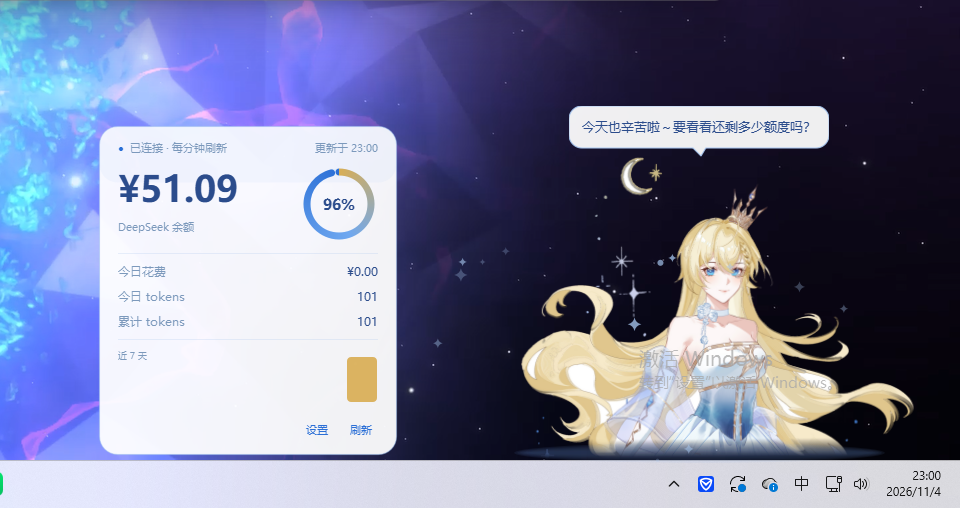

# 星璃 Hoshiri · 桌宠

> **下载即用**：[Releases](https://github.com/Qimin-Shen/hoshiri-pet/releases/latest) — 当前源码整合版本为 **2.2（尚未发布 Release）**；已发布安装包版本与源码版本可能不同，请以 Release 页面为准。

常驻桌面右下角的 AI 伙伴，绑定 DeepSeek，实时显示额度。



*实机截图：右下角停靠、额度面板、对话气泡。*

---

## ⚠️ 使用许可

**「星璃 Hoshiri」是个人原创角色（OC），不是公共素材。**代码为 MIT；角色立绘及项目派生图片版权所有，禁止商业用途、不得用于模型训练或图生图素材。详见 `LICENSE`。

## 功能

| 模块 | 说明 |
|---|---|
| 形象 | 立绘自动抠图，贴在任务栏上沿，像从屏幕后面探出上半身 |
| 动画 | 60fps 待机、呼吸、头发摆动、眨眼、星屑及拖拽特效 |
| 交互 | 拖拽移动、位置记忆、双击聊天、右键菜单、系统托盘 |
| 对话 | DeepSeek / OpenAI 兼容 / Anthropic 流式聊天 |
| 主动搭话 | 设置最高目标频率（次/分）；保留忙碌暂停、勿扰和未回应退避 |
| 角色档案 | 完整原创星璃长人设，可在设置中查看、编辑及恢复默认 |
| 本地记忆 | 用户逐条确认后保存在本机；可搜索、编辑、删除、暂停及清空 |
| 时间与天气 | 用户分别启用；天气采用手动城市，不读取设备定位 |
| 额度 | 余额面板、今日花费、tokens 与近 7 天统计 |
| 安全存储 | API Key 存于 Windows 凭据管理器 |

## 版本 2.2：本地陪伴升级与官方服务商默认地址

本版本合并本地 2.1 的自适应搭话、原创长人设、本机记忆、时间/天气上下文，与远端 v0.5.0 的 OpenAI / Anthropic 官方默认 API 地址变更。

- 新安装时 OpenAI 默认 Base URL 为 `https://api.openai.com/v1`（模型默认 `gpt-4o-mini`）；Anthropic 默认 Base URL 为 `https://api.anthropic.com`（模型默认 `claude-3-5-sonnet-latest`）。按服务商现行账户、模型可用性和计费策略选择模型并确认 API Key。
- 已有配置文件若保存了明确的 `provider_urls` / `provider_models` 值，这些用户值优先于默认值，更新不会擅自替换。若配置缺少对应字段，才使用程序默认值。
- 设置中可配置桌宠主动搭话最高目标频率 `0.01–10 次/分`；例如 `0.1 次/分`约每 10 分钟一次，`1 次/分`约每分钟一次。实际搭话可能因桌宠正在忙、安静时段或未回应退避而更少；关闭主动搭话开关可暂停。主动搭话是本地短句，不调用模型 API。旧配置默认约 `0.02 次/分`（约每 50 分钟一次）。
- 星璃角色档案为原创长文本，可编辑、预览和恢复默认；旧版人设短字段迁入档案附注。
- 本机记忆只在用户确认后保存；用户可浏览、搜索、编辑、删除、暂停或清空。记忆存于本机 SQLite，不持久化完整聊天记录；相关记忆被召回时会随本轮对话发给当前选择的模型服务商。检索依赖本地词项匹配，可能漏召回或误匹配；敏感信息过滤为启发式，不保证绝对准确。
- 时间和天气独立可选；天气仅用手动城市与 Open-Meteo，失败时不阻塞普通聊天。
- 屏幕/游戏状态识别及语音输入/输出未实现，本版本不读取屏幕、游戏状态或麦克风。

## 快速开始

```bat
run.bat
```

首次运行自动创建 `.venv` 并安装依赖（走清华镜像）。

## 首次配置

1. 去 <https://platform.deepseek.com/api_keys> 创建 API Key。
2. 右键桌宠 → **设置…** → 选择服务商，填写对应 API Key 和模型，再保存。
3. 双击桌宠即可聊天。

> API Key 存在 Windows 凭据管理器（服务名 `HoshiriPet`），不写入配置文件或用量数据库。角色档案和本轮召回记忆会随请求发送给所选模型服务商。

## 数据说明

| 数据 | 存储/来源 |
|---|---|
| 配置、人设、主动对话/时间/天气开关与城市 | `%APPDATA%\\HoshiriPet\\config.json` |
| 确认的记忆与忽略的候选 | `%APPDATA%\\HoshiriPet\\usage.db` 的 SQLite 表，仅本机保存 |
| 聊天记录 | 仅本次运行内存，不持久化；当前对话上下文随请求发送给所选模型服务商 |
| tokens 与余额采样 | `%APPDATA%\\HoshiriPet\\usage.db` |
| 天气 | Open-Meteo；仅在开启且填写城市后请求，30 分钟缓存 |

## 测试

```bat
.venv\\Scripts\\python.exe -m unittest discover -s tests -v
```

## 打包

```powershell
powershell -ExecutionPolicy Bypass -File build.ps1
```

产物在 `dist\\HoshiriPet\\`（onedir）。

## 开机自启

右键桌宠 → **开机自启**，勾选即写入注册表，取消即删除。

## 项目结构

```
hoshiri-pet/
├─ src/
│  ├─ main.py / pet.py       入口、桌宠窗口和交互调度
│  ├─ chatter.py             主动搭话规则与频率调度
│  ├─ config.py              配置、服务商默认值与旧人设迁移
│  ├─ memory.py              本地记忆、候选与检索
│  ├─ environment.py         用户启用的时间/天气上下文
│  ├─ api_client.py          模型协议与提示词分层
│  ├─ store.py               用量/余额的 SQLite 存储
│  └─ ui/                    设置、记忆管理、气泡、输入框、面板
├─ tests/                    API、版本迁移、调度与记忆测试
├─ tools/ / docs/            构建工具与截图
├─ ART-SPEC.md               角色美术设定
└─ build.ps1                 打包脚本
```

## 后续规划（未实现）

- 屏幕内容/游戏状态识别与据此对话（需另行设计并显式授权）
- 语音输入、语音合成及连续语音对话
- 拖拽挣扎、睡觉等状态动画；换装/主题

## 许可

- **代码**：[MIT](LICENSE)
- **角色形象**：版权所有，禁止商业用途，详见 `LICENSE`。
