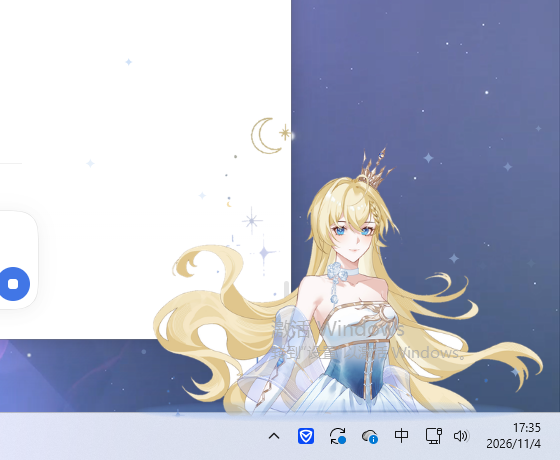
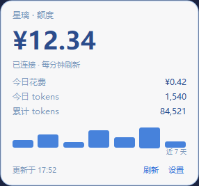
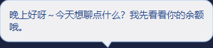

# 星璃 Hoshiri · 桌宠

> **下载即用**：[Releases](https://github.com/Qimin-Shen/hoshiri-pet/releases/latest) — 解压 `HoshiriPet-v0.3.1-win64.zip`，双击 `HoshiriPet.exe`，无需安装 Python。

常驻桌面右下角的 AI 伙伴，绑定 DeepSeek，实时显示额度。



## 功能

| 模块 | 说明 |
|---|---|
| 形象 | 立绘自动抠图，贴在任务栏上沿，像从屏幕后面探出上半身 |
| 待机动画 | 60fps 渲染，呼吸起伏、轻微摇摆、星屑粒子 |
| 头发摆动 | 逐像素行位移 + 整体缓摆，9.5 秒一个来回，拖拽有惯性甩动 |
| 眨眼 | 10 档眼睑闭合序列，闭合快张开慢，2.6–6.8 秒随机一次 |
| 特效 | 呼吸光晕、点击星屑爆散、拖拽拖尾、思考跳动点 |
| 交互 | 拖拽移动、位置记忆、双击聊天、右键菜单、系统托盘 |
| 对话 | DeepSeek 流式输出，气泡逐字显示，带上下文（最近 10 轮） |
| 额度 | 仪表盘：余额、今日花费、今日 tokens、累计 tokens、近 7 天柱状图 |
| 设置 | API Key 存入 Windows 凭据管理器，不落明文 |

<p>
  
  
</p>

## 快速开始

```bat
run.bat
```

首次运行会自动创建 `.venv` 并安装依赖（走清华镜像）。

## 首次配置

1. 去 <https://platform.deepseek.com/api_keys> 创建 API Key
2. 右键桌宠 → **设置…** → 粘贴 Key → 保存
3. 双击桌宠即可聊天

> Key 存在 Windows 凭据管理器（服务名 `HoshiriPet`），配置文件和数据库里都不会出现明文。

## 数据说明

| 指标 | 来源 |
|---|---|
| 余额 | `GET /user/balance`，每分钟刷新 |
| 今日花费 | 当天首末余额差值（真实扣费，不受单价变动影响） |
| 今日 / 累计 tokens | 每次对话返回的 `usage` 累加，存本地 SQLite |

数据文件：`%APPDATA%\HoshiriPet\usage.db`

## 目录

```
hoshiri-pet/
├─ src/
│  ├─ main.py        入口
│  ├─ pet.py         主窗口：绘制、拖拽、对话调度、额度轮询
│  ├─ deepseek.py    API 客户端（流式对话 + 余额）
│  ├─ store.py       本地用量 SQLite
│  ├─ keystore.py    凭据管理器读写
│  ├─ config.py      配置
│  ├─ particles.py   星屑粒子
│  └─ ui/
│     ├─ bubble.py   对话气泡
│     ├─ chatbox.py  输入框
│     ├─ panel.py    额度仪表盘
│     └─ settings.py 设置对话框
├─ tools/
│  ├─ build_assets.py  立绘抠图 → 透明素材
│  └─ render_ui.py     UI 离屏渲染（出图用）
├─ assets/raw/   原始素材（不入库）
├─ assets/out/   处理后的素材
└─ ART-SPEC.md   角色设定与出图提示词
```

## 路线图

- [x] 透明置顶窗口 + 贴边停靠
- [x] 呼吸 / 星屑动画
- [x] 形象切换、大小调节、托盘
- [x] DeepSeek 流式对话
- [x] 额度仪表盘
- [ ] 拖拽、思考、睡觉等状态动画
- [ ] 开机自启
- [ ] PyInstaller 打包 exe

## 换电脑部署

```bat
git clone https://github.com/Qimin-Shen/hoshiri-pet.git
cd hoshiri-pet
run.bat
```

## 素材说明

角色「星璃 Hoshiri」为作者原创 OC，由作者本人提供并授权本项目使用。
