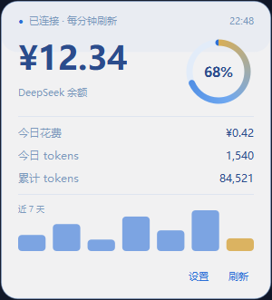
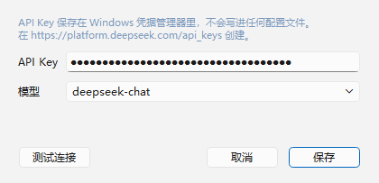

# 星璃 Hoshiri · 桌宠

> **下载即用**：[Releases](https://github.com/Qimin-Shen/hoshiri-pet/releases/latest) — 解压 `HoshiriPet-v0.4.0-win64.zip`，双击 `HoshiriPet.exe`，无需安装 Python。

常驻桌面右下角的 AI 伙伴，绑定 DeepSeek，实时显示额度。


---

## ⚠️ 使用许可（请先看这一节）

**「星璃 Hoshiri」是我的个人原创角色（OC），不是公共素材。**

| | |
|---|---|
| ✅ **允许** | 克隆仓库、本地运行、阅读源码、提 Issue、Fork 后自己改着玩 |
| ❌ **禁止** | 任何形式的**商业用途**——售卖、内购、广告变现、随商品分发、为商业产品导流 |
| ❌ **禁止** | 把角色当作公司 / 产品 / 店铺的吉祥物或代言形象 |
| ❌ **禁止** | 单独提取立绘、头像用于周边、印刷品、付费头像 |
| ❌ **禁止** | 用于 AI 模型训练或图生图素材 |

- **代码**：MIT，可自由使用
- **角色形象（立绘、头像、以及本项目派生的所有图片素材）**：版权所有，**不适用 MIT，禁止商用**

商业授权请联系作者。

---

## 功能

| 模块 | 说明 |
|---|---|
| 形象 | 立绘自动抠图，贴在任务栏上沿，像从屏幕后面探出上半身 |
| 待机动画 | 60fps 渲染，呼吸起伏、轻微摇摆、星屑粒子 |
| 头发摆动 | 逐像素行位移 + 整体缓摆，9.5 秒一个来回，拖拽有惯性甩动 |
| 眨眼 | 10 档眼睑闭合序列，闭合快张开慢，2.6–6.8 秒随机一次 |
| 特效 | 点击星屑爆散、拖拽拖尾、思考跳动点 |
| 交互 | 拖拽移动、位置记忆、双击聊天、右键菜单、系统托盘 |
| 对话 | DeepSeek 流式输出，气泡逐字显示；输入框平时收起，双击唤出，发送即隐 |
| 主动搭话 | 按时间 / 余额 / 久坐 / 冷落自动开口，可在右键菜单关闭 |
| 额度 | 毛玻璃面板：余额环、今日花费、今日 tokens、累计 tokens、近 7 天柱状图 |
| 设置 | API Key 存入 Windows 凭据管理器，不落明文 |
| 开机自启 | 右键菜单开关，写 `HKCU\...\Run` |

<p>
  
  
</p>

## 快速开始

```bat
run.bat
```

首次运行会自动创建 `.venv` 并安装依赖（走清华镜像）。

## 首次配置

1. 去 <https://platform.deepseek.com/api_keys> 创建 API Key
2. 右键桌宠 → **设置…** → 粘贴 Key → 保存
3. 双击桌宠即可聊天

> Key 存在 Windows 凭据管理器（服务名 `HoshiriPet`），配置文件和数据库里都不会出现明文。

## 数据说明

| 指标 | 来源 |
|---|---|
| 余额 | `GET /user/balance`，每分钟刷新 |
| 今日花费 | 当天首末余额差值（真实扣费，不受单价变动影响） |
| 今日 / 累计 tokens | 每次对话返回的 `usage` 累加，存本地 SQLite |
| 余额环 | 当前余额 ÷ 近 30 天最高余额 |

数据文件：`%APPDATA%\HoshiriPet\usage.db`

## 打包成 exe

```powershell
powershell -ExecutionPolicy Bypass -File build.ps1
```

产物在 `dist\HoshiriPet\`（约 160 MB，onedir，启动快）。

## 开机自启

右键桌宠 → **开机自启**，勾选即写入注册表，取消即删除。

手动方式：

```powershell
Set-ItemProperty HKCU:\Software\Microsoft\Windows\CurrentVersion\Run `
  -Name HoshiriPet -Value '"C:\DevStack\apps\HoshiriPet\HoshiriPet.exe"'
```

## 目录

```
hoshiri-pet/
├─ src/
│  ├─ main.py        入口 + 单实例锁
│  ├─ pet.py         主窗口：绘制、拖拽、对话调度、额度轮询
│  ├─ layers.py      分层渲染（身体 / 头发 / 眨眼）
│  ├─ effects.py     点击爆散、拖拽拖尾
│  ├─ particles.py   星屑粒子
│  ├─ chatter.py     主动搭话的规则与台词
│  ├─ deepseek.py    API 客户端（流式对话 + 余额）
│  ├─ store.py       本地用量 SQLite
│  ├─ keystore.py    凭据管理器读写
│  ├─ autostart.py   开机自启
│  ├─ paths.py       打包/源码两种模式的资源路径
│  ├─ config.py      配置
│  └─ ui/
│     ├─ bubble.py   对话气泡
│     ├─ chatbox.py  输入框
│     ├─ panel.py    额度面板
│     └─ settings.py 设置对话框
├─ tools/
│  ├─ build_layers.py  立绘 → 分层素材
│  ├─ build_eyes.py    眨眼序列帧
│  ├─ make_icon.py     生成 .ico
│  └─ measure_fps.py   重绘间隔测量
├─ assets/raw/   原始素材（不入库）
├─ assets/out/   处理后的素材
├─ docs/         截图
├─ ART-SPEC.md   角色设定与出图提示词
└─ build.ps1     打包脚本
```

## 路线图

- [x] 透明置顶窗口 + 贴边停靠
- [x] 呼吸 / 星屑动画
- [x] 大小调节、托盘
- [x] DeepSeek 流式对话
- [x] 额度面板
- [x] 分层渲染 + 头发摆动 + 眨眼
- [x] 打包 exe + 开机自启
- [x] 主动搭话
- [ ] 拖拽挣扎、睡觉等状态动画
- [ ] 换装 / 主题

## 版本

| 版本 | 内容 |
|---|---|
| v0.4.0 | 额度面板重做、输入框自动收起、主动搭话 |
| v0.3.2 | 修复头发形变的越界崩溃 |
| v0.3.1 | 60fps 时基、逐像素头发形变、眨眼序列帧（已下架） |
| v0.3.0 | 分层渲染、头发摆动、眨眼、特效 |
| v0.2.0 | 打包、开机自启、DeepSeek 对话、额度仪表盘 |
| v0.1.0 | 贴边停靠、星屑动画 |

## 换电脑部署

```bat
git clone https://github.com/Qimin-Shen/hoshiri-pet.git
cd hoshiri-pet
run.bat
```

或直接下载 Release 里的 zip，解压双击。

## 许可

- **代码**：[MIT](LICENSE)
- **角色形象**：Copyright © 2026 Qimin-Shen，保留所有权利。**禁止商业用途**，详见 [LICENSE](LICENSE) 末尾条款。
